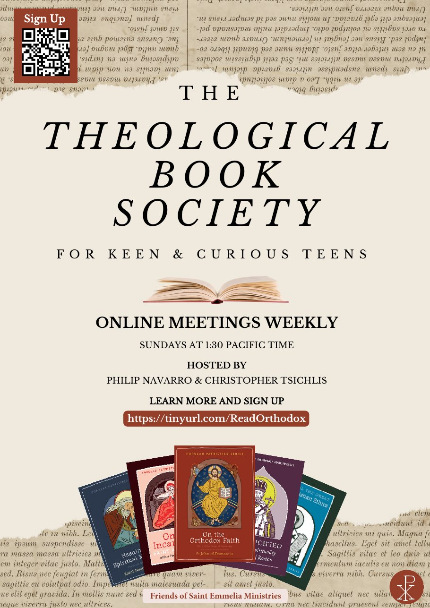

If you teach, parent, or mentor a teenager who asks good questions about the faith, here is an invitation worth passing along.

**The Theological Book Society** is a free online reading group for keen and curious teens, hosted by Philip Navarro and Christopher Tsichlis with the blessing of Saint Emmelia Ministries. Each week the group reads classical Christian texts together, so students grow both intellectually and spiritually. Because the reading happens during the meeting, no preparation is required.

**When:** Sundays at 1:30 PM Pacific (4:30 PM Eastern), online.

**Sign up:** [tinyurl.com/ReadOrthodox](https://tinyurl.com/ReadOrthodox)

## Meet the hosts

**Philip Navarro** graduated from the Great Books program at St. John's College (BA in Liberal Arts, 2001), went on to theological studies in Greece, and earned an MS in Special Education from Johns Hopkins University. He is a special educator and a youth worker at St. Mark Church (OCA) in Bethesda, Maryland.

**Christopher Tsichlis** grew up in Southern California and earned a BA in Philosophy and Theology from Boston College. He holds theology degrees from Holy Cross Greek Orthodox School of Theology and Harvard, plus a Master of Arts in Teaching from the University of Southern California. He teaches at a Catholic school near Washington, DC, and is a member of St. Constantine and Helen Greek Orthodox Church in DC.

## Why we're sharing it

At NOUS, we believe Orthodox students deserve more than information about the faith. They deserve time spent with the great texts of the Church, alongside adults who love those texts. A group like this one is a gift to schools and homeschool co-ops alike, especially for students who are ready for more than their regular curriculum offers.

Teachers and heads of school, please pass this along to your older students and their families, and feel free to print the flyer for your bulletin board.

[Download the flyer (PDF)](/assets/blog/theological-book-society/theological-book-society-flyer.pdf)
